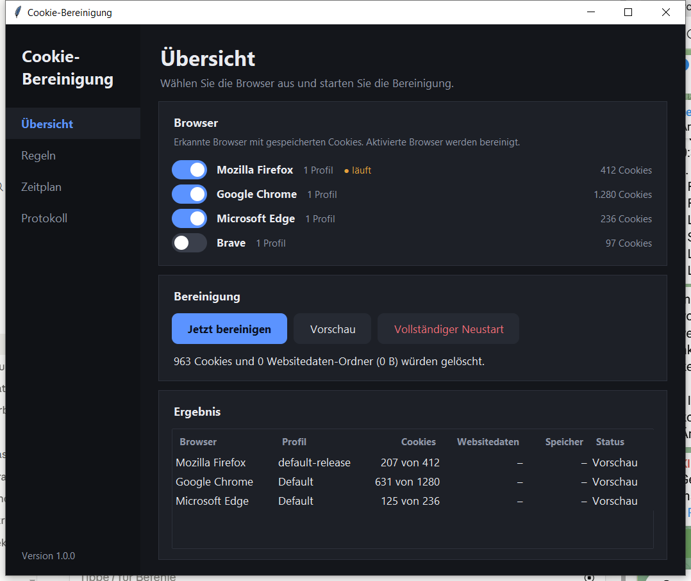
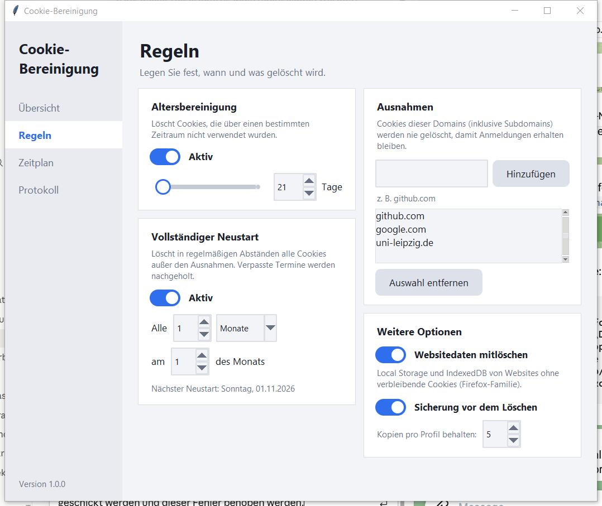

# Cookie-Bereinigung

Löscht veraltete Cookies automatisch – in 18 Windows-Browsern, nach Alter oder als regelmäßiger vollständiger Neustart, mit Ausnahmeliste, Sicherung und Zeitplan. Als eigenständiges Programm, ohne Installation von Python.

**[Cookie-Bereinigung herunterladen](https://github.com/paul-teumer/Cookie-Bereinigung/releases/latest/download/Cookie-Bereinigung.exe)** – speichern und per Doppelklick starten.



## Funktionen

- **Altersbereinigung** – entfernt Cookies, die länger als 1 bis 365 Tage nicht verwendet wurden.
- **Vollständiger Neustart** – löscht in festem Rhythmus (alle *n* Tage, Wochen oder Monate; wahlweise an einem Wochentag oder Monatstag) alle Cookies. Verpasste Termine werden beim nächsten Lauf nachgeholt.
- **Ausnahmen** – Domains (einschließlich Subdomains), deren Cookies nie gelöscht werden, damit Anmeldungen bestehen bleiben.
- **Websitedaten** – entfernt in Browsern der Firefox-Familie zusätzlich Local Storage und IndexedDB von Websites ohne verbleibende Cookies.
- **Sicherung** – vor jedem Löschen wird eine Kopie der Cookie-Datenbank angelegt (1 bis 50 Kopien je Profil).
- **Vorschau** – zeigt je Profil, was gelöscht würde, ohne etwas zu verändern.
- **Zeitplan** – richtet eine Aufgabe der Windows-Aufgabenplanung ein (täglich zur gewählten Uhrzeit; war der Rechner dann aus, wird der Lauf nach dem Einschalten nachgeholt; optional zusätzlich bei jeder Anmeldung).
- **Protokoll** – Verlauf der letzten Läufe mit gelöschten Cookies und freigegebenem Speicher.
- **Helles und dunkles Design** nach Windows-Einstellung; Bedienung auch per Kommandozeile.



## Unterstützte Browser

| Familie | Browser |
| --- | --- |
| Firefox | Mozilla Firefox, LibreWolf, Waterfox, Floorp, Zen Browser, Pale Moon |
| Chromium | Google Chrome (Stable, Beta, Canary), Microsoft Edge, Brave, Vivaldi, Opera, Opera GX, Chromium, Yandex Browser, Thorium, Epic Privacy Browser |

Alle Profile eines Browsers werden erkannt, bei Chromium-Browsern mit dem im Browser vergebenen Profilnamen.

## Installation und Start

**Ohne Installation:** `Cookie-Bereinigung.exe` aus den [Releases](https://github.com/paul-teumer/Cookie-Bereinigung/releases) laden und starten. Weder Python noch weitere Pakete sind nötig; die Kommandozeilen-Befehle unten funktionieren auch mit der `.exe` (`Cookie-Bereinigung.exe run --dry-run`).

**Aus dem Quelltext:** Windows 10 oder 11 und Python ab 3.10 mit Tkinter (Bestandteil der Standardinstallation); es werden keine weiteren Pakete benötigt.

```bash
git clone https://github.com/paul-teumer/Cookie-Bereinigung.git
cd Cookie-Bereinigung
pythonw cookie_bereinigung.pyw
```

## Kommandozeile

```bash
python -m cookie_cleaner browsers          # erkannte Browser und Profile
python -m cookie_cleaner run --dry-run     # Vorschau der Altersbereinigung
python -m cookie_cleaner run               # fällige Bereinigung gemäß Einstellungen
python -m cookie_cleaner run --full        # vollständigen Neustart erzwingen
python -m cookie_cleaner schedule install  # Zeitplan einrichten (remove / status)
```

Der Rückgabewert ist 1, wenn Profile gesperrt waren, und 2, wenn noch kein Browser ausgewählt wurde.

## Funktionsweise und Grenzen

- Die Bereinigung ändert direkt die Cookie-Datenbanken der Profile. Unter Windows hält ein laufender **Chromium-Browser** seine Datenbank gesperrt; dieses Profil wird dann übersprungen und gemeldet, die Vorschau arbeitet auf einer Kopie. Firefox-Browser erlauben den Zugriff auch im Betrieb; gelöschte Cookies sind dort nach einem Neustart des Browsers wirksam.
- Als Alter gilt der letzte Zugriff auf das Cookie. Chromium aktualisiert diesen Wert nur etwa einmal täglich.
- Bei Chromium-Browsern werden ausschließlich Cookies gelöscht, keine Websitedaten.
- Bei Websitedaten ohne jedes zugehörige Cookie fehlt die Altersangabe; sie werden bei aktivierter Option mit bereinigt.
- Einstellungen, Protokoll und Sicherungen liegen unter `%LOCALAPPDATA%\Cookie-Bereinigung`.

## Entwicklung

```bash
python -m unittest discover -s tests -t .
python erstellen.py   # baut Cookie-Bereinigung.exe (benötigt PyInstaller)
```

## Lizenz

Copyright © 2026 Paul Teumer. Lizenziert unter der [GNU General Public License v3.0](LICENSE).
